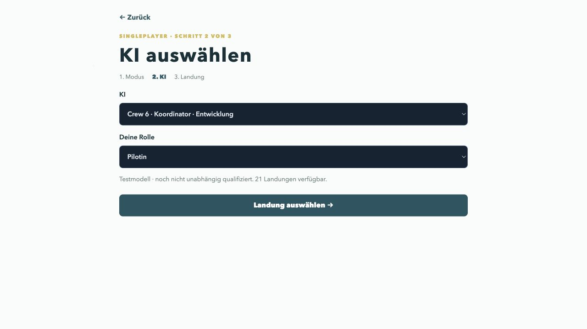

# Fähigkeiten und Wind: Arbeit an der nächsten Crew

Arbeitsstand vom 28. Oktober 2026. Die bisherigen fünf Crews und ihre Messdaten
bleiben unverändert. Die neue Strategie ist ein zusätzliches Profil 15, keine
Änderung der neuronalen Gewichte. Eine Veröffentlichung setzt eine vollständige
frische Bestätigung gegen Crew 5 voraus.

## Was bisher fehlte

Der bisherige Handplaner bewertet noch nicht ausgegebene Synchronisationswürfel
nicht als Planungsziel. Seine Fortschrittspunkte bevorzugen deshalb manchmal
mehrere neue Klappen/Fahrwerke in einer Runde, obwohl verteilt mehr Bonuswürfel
entstünden. Bei Wind bewertet er vor allem die aktuelle Runde.

Wichtig bei **Kontrolle**: Gleiche Ruder halten die vorhandene Fluglage. Bei einer
bestehenden Neigung dreht sich das Windrad trotzdem weiter und es gibt Kaffee.
Waagerecht bleiben und Kaffee sammeln kann dagegen die nötige Winddrehung
verhindern. Rückenwind ist kein automatischer Verlust: Mit genügenden Bremsen
sind manche Landungen möglich; Gegenwind erleichtert sie aber erheblich.

## Neue Bausteine

- Zukunftswert für noch mögliche frische Klappen/Fahrwerk-Paare. Vier Klappen
  und drei Fahrwerke erlauben dem Co-Piloten einen zusätzlichen ungepaarten
  Fortschritt. Im Notfall darf die reale Engine weiterhin grüne Felder belegen.
- Der Bonus zählt nur als erwarteter Nutzen. Ein noch nicht gewürfelter Würfel
  wird nie als sichere Ressource für Physik oder Pflichtaufgaben eingesetzt.
- Der Verkehrswürfel hat **2, 3, 3, 4, 4, 5**. Die Nutzenabschätzung verwendet
  diese Verteilung und prüft tatsächlich noch nützliche Zielfelder. Erneutes
  Belegen grüner Schalter erzeugt keinen künstlichen Fortschrittswert.
- Ein endlicher Windhorizont berücksichtigt Position auf dem Windrad, Fluglage,
  Reststrecke, verbleibende Runden, Kurven und Aerodynamik. Gegenwind zu früh
  kann die Reichweite zerstören; eine rein möglichst negative Windzahl wäre
  deshalb ebenfalls eine schlechte Regel.
- Gemeinsame Aufgaben werden mit verschiedenen hypothetischen Partnerwürfeln
  und einem einzigen Kaffeebudget gerechnet. Überlappende Möglichkeiten werden
  vereinigt, statt ihre Wahrscheinlichkeiten mehrfach zu addieren.

Der Windhorizont bleibt bewusst eine **optimistische Planungspräferenz**:
Zukünftige konkrete Würfel sind unbekannt; Funkarbeit und künftige Upgrades sind
nicht vollständig mit ihren Ressourcen simuliert. Deshalb darf der Horizont
keine neue Garantie oder harte Legalitätsprüfung vortäuschen.

## Entwicklung und Trennung der Tests

Der erste vollständige Entwicklungstest umfasste 19 Kombinationen mit je drei
Partien pro Strategie: 6/57 Siege statt 4/57 und 90 statt 47 Bonuswürfel. Er
zeigte aber auch 20 statt 6 erneute Schalterbelegungen. Dieser Stand wurde
**nicht veröffentlicht**. Der größere Folgelauf wurde wegen dieser Schwäche
und einer kurzen Temperaturspitze von 75,28 °C abgebrochen; seine unvollständigen
Ergebnisse sind keine Freigabegrundlage.

Die Korrektur verwendet den tatsächlichen erwarteten Bonusnutzen und eine
höhere Bewertung der verbrauchten grünen Schalter. Alle Vergleichsdateien und
Manifeste liegen in `ai/experiments/ability-strategy-2026-10-28/`.
Entwicklung und Bestätigung verwenden getrennte benannte Startseed-Kohorten.
Gleiche Startseeds bedeuten gemeinsame Ausgangszufälle; zusätzliche Bonuswürfe
können die spätere Zufallsfolge der beiden Strategien unterschiedlich weit
verbrauchen.

Vor einer neuen Crew sind mindestens fünf Partien auf jedem der 192 registrierten
Strecken/Kartenfälle vorgesehen. Die vorab festgelegte Hürde verlangt mindestens
fünf zusätzliche Siege insgesamt und in den betroffenen Wind-/Synchronisationsfällen, einen höheren nach Routen gleich gewichteten Mittelwert,
keine erkannten vermeidbaren unmittelbaren Verluste und keine Abbrüche wegen
Schrittlimits. Fälle ohne Wind und ohne Synchronisation verwenden exakt die alte Strategie. Ohne Echtzeitmodul wird der identische Verlauf übernommen; Echtzeitfälle werden mit tatsächlicher Wanduhr separat gespielt, da die Zeit unabhängig vom Algorithmus schwanken kann. Auch Nullquoten werden veröffentlicht; das ist keine Zusage einer
Mindestgewinnrate auf jeder Route.

## Literatur und Grenzen

[Foerster et al., Bayesian Action Decoder](https://arxiv.org/abs/1811.01458)
behandeln Kooperation mit öffentlichen Überzeugungen in Spielen mit verdeckten
Informationen. Hier dient das als Orientierung für die Informationsgrenze;
implementiert ist ein erklärtes Fair-Hand-Modell, kein vollständiger BAD-Agent.

[Ng, Harada und Russell, Reward Shaping](https://ai.stanford.edu/~ang/papers/shaping-icml99.pdf)
zeigen, warum zusätzliche Belohnungen unerwünschte Strategien erzeugen können.
Das Bonus-Sammeln über grüne Schalter ist ein konkreter Anlass, Nutzen und
verbrauchte Ressourcen gemeinsam zu bewerten. Der hiesige begrenzte Planer
beansprucht keine theoretische Garantie der Policy-Invarianz aus diesem Papier.

[Hu et al., Other-Play](https://proceedings.mlr.press/v119/hu20a.html) beschreiben,
wie reines Selbstspiel schwer übertragbare Absprachen lernen kann. [Strouse et
al., Fictitious Co-Play](https://arxiv.org/abs/2110.08176) verwenden verschiedene
Partner und historische Trainingsstände, um die Zusammenarbeit mit unbekannten
Partnern zu verbessern. Das spricht für die Idee wechselnder Crews; wahlloses
gegenseitiges Training garantiert aber keine Verbesserung.

Zusätzlich ist deshalb ein festgelegter Vergleich von Crew 6 als Pilot oder
Co-Pilot mit unveränderter Crew 5 auf den 19 Entwicklungsfällen vorgesehen:
je drei Startfolgen für Crew 5/5 und beide gemischten Besetzungen. Die Startfolgen
sind von der Bestätigung getrennt. Diese Diagnose trainiert keine Gewichte und
ist kein Ersatz für eine Untersuchung mit menschlichen Spielern.

## Unabhängige Bestätigung

Der eingefrorene Stand bestand die vorab festgelegte Hürde: 103 → 122 Siege
über je 960 repräsentierte Partien; auf den betroffenen Wind-/Synchronisationsfällen
29 → 48. Tatsächlich gespielt wurden insgesamt 1.560 Partien. 360 identische
Verläufe unveränderter Fälle ohne Echtzeit wurden analytisch übernommen.
Die 21 Originalstrecken verbessern sich bei gleicher Routengewichtung um
1,30 Prozentpunkte. Das ist ein moderater Schritt, kein allgemeines Top-Niveau.

Synchronisation gewinnt deutlich: 23/275 → 41/275 erfolgreiche Landungen und
226 → 559 gezählte Zusatzwurfaktionen. Bei Wind sind es nur 6/255 → 8/255 Siege.
Kaffee-Gegenkorrekturen (2 → 7) und der vereinfachte Reichweitenindikator
(76 → 121) bleiben offene Schwächen. Die [Routentabelle](KI-ROUTENVERGLEICH-2026-10-28.md)
enthält sämtliche Originalstrecken, Stichprobengrößen und die Rohdatenverweise.

Während einer zwischenzeitlichen hohen Chrome-/Grafiklast stieg das gemessene
Sensormaximum auf 84,03 °C. Beide KI-Arbeiter waren dabei vollständig gestoppt
(0 % CPU); die Temperaturüberwachung setzte erst nach Abkühlung unter 60 °C
fort. Die Daten behalten diese reale Wanduhr einschließlich Temperaturpausen.
Das unabhängige Ergebnis ist daher auch nach Echtzeit- und unveränderten
Kontrollfällen getrennt ausgewiesen. Zukünftige Diagnosen nutzen zunächst
nur einen Hintergrund-Arbeiter.

Die vorhandenen Spielerdaten wurden nicht heimlich in neue Gewichte umgewandelt:
Im zuletzt geprüften Archiv standen 28 explizite Schema-3-Bewertungen aus 13
Sitzungen zur Verfügung; die bestehende Trainingsroutine verlangt mindestens
64 verwertbare Bewertungen. Neue menschliche Korrekturen können künftig
zusätzliche positive Beispiele liefern. Crew 6 verwendet unveränderte Gewichte.

## Browser und Offline-Paket

Vier vollständige technische Python/WASM-/JavaScript-Kontrollpartien wurden
über die echte Browseroberfläche ausgeführt (226 Entscheidungen, keine
ungültige Aktion oder Schrittlimittrunkierung). Die langsamste Entscheidung
auf diesem Mac dauerte etwa 0,76 Sekunden. Das ist kein iPhone-Leistungstest
und kein Gewinnratenbenchmark.

Der reale Wechsel eines vollständig gespeicherten Fünf-Crew-Pakets auf die
Sechs-Crew-Version behielt den Offline-Status. Alle sechs Crews benötigen
weiterhin nur vier verschiedene Gewichtsdateien: zusammen 11.263.438 Bytes.
Das gesamte Paket umfasst 30.578.696 Bytes zuzüglich Inventardatei. Die neue
Crew lädt keine zusätzliche Kopie der identischen Gewichte herunter.
Crew 6 steht im Auswahlmenü vor Crew 5; Crew 1 bleibt unten.

## Gemischte Crews: unabhängige Diagnose

19 gezielt gewählte Wind-/Synchronisationsfälle, drei neue Startfolgen pro Fall, insgesamt 171 tatsächlich gespielte Partien. Crew 5/5 gewinnt 8/57, Crew 6 als Pilot neben Crew 5 gewinnt 4/57, Crew 6 als Co-Pilot neben Crew 5 gewinnt 10/57. Keine auditierten vermeidbaren Sofortverluste oder Schrittlimit-Abbrüche. Das ist eine kleine separate Diagnose, kein Nachweis für das Zusammenspiel mit Menschen und keine Trainingsrunde. Die Abweichung nach Rollen spricht dafür, künftig wechselnde Partner und gemeinsame öffentliche Ziele gezielt zu prüfen. Sie rechtfertigt keine Behauptung, Crew 6 sei mit jedem Partner besser. Die maximal gemessene Temperatur dieses Laufs betrug 58,97 °C.

Die abschließende vollständige Python-Prüfung bestand mit 648 Tests in 629,9 Sekunden; die drei später ergänzten Zeitlimit-Tests bestehen zusätzlich. Temperaturmaximum dieses Testlaufs: 62,13 °C. Neue UI-Optionen verändern das eingefrorene autonome Profil nicht; die Bestätigung verwendet weiterhin die Originalregeln einschließlich Echtzeit.

Abschließender Offline-Test mit angehaltenem HTTP-Server und überprüft geschlossenem Port 8769: App aus dem Service-Worker-Cache neu geladen, alle sechs Crews verfügbar, neue YUL-Partie mit Crew 6 als Pilot gestartet. Die KI legte tatsächlich eine blaue 2 auf die erste Bremse und übergab an den menschlichen Co-Piloten. Danach wurde der Webserver aus dem Hauptverzeichnis wieder gestartet.
