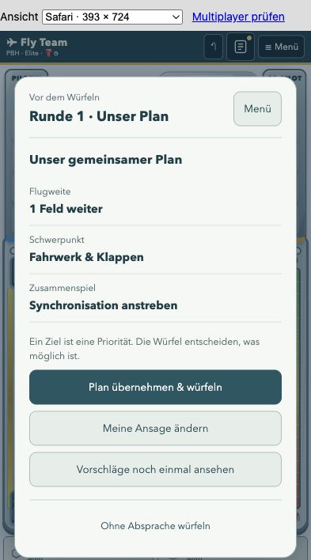

# Gemeinsamer Rundenplan · umgesetzt am 28. Oktober 2026

Der schrittweise Rundenplan ist in „Mit KI spielen“ und der KI-ndergartenbetreuung für alle sechs Crews implementiert. Die folgenden öffentlichen Ziele sind an die tatsächliche Handplanung angeschlossen. Ein zusätzliches Sprachmodell wird dafür nicht heruntergeladen.

## Ablauf in der App

Vor jeder Runde zeigt die KI nacheinander drei kombinierbare Ziele: gewünschte Flugweite, einen Schwerpunkt und gegebenenfalls eine besondere Absprache für die aktiven Module/Karten. Beispiel: ein Feld weiterfliegen, Flugzeuge vor uns entfernen, Synchronisation anstreben. Eine kurze Begründung kann bei Bedarf eingeblendet werden.

Ein Daumen hoch übernimmt einen Vorschlag. Ein Daumen runter lehnt diesen Vorschlag ab und bietet passende Alternativen an; beim Flugziel etwa 0 oder 2 statt 1 Feld. Nach den drei Vorschlägen wird der ganze Plan angezeigt und gemeinsam mit „Plan übernehmen & würfeln“ bestätigt. Über „Plan“ im Kopf bleibt die Absprache lesbar. „Ohne Absprache würfeln“ verwendet exakt die bisherige Crew-Strategie.

Über **„Meine Ansage“** kann der Mensch unabhängig von den KI-Vorschlägen eine Flugweite, einen Schwerpunkt und eine Absprache auswählen. Danach zeigt die KI die verstandenen Ziele zur Bestätigung. Die Auswahl heißt ausdrücklich „Fahrwerk & Klappen“, statt des missverständlichen „Fokus Ausbau“. Optionaler Freitext würde später dieselben strukturierten Ziele erzeugen und ebenfalls vor der Übernahme angezeigt werden.

Die KI erzeugt die Vorschläge ausschließlich aus der öffentlichen Lage: Entfernung, Höhe, Verkehr, Fluglage, Wind, Ausbaustand und Karten. Sie benutzt dafür weder ihre verdeckten Würfel noch die des Menschen. Nach der Bestätigung wird der Plan für diese Runde gesperrt. Ein Neuwurf öffnet die Absprache nicht erneut. Die Echtzeituhr startet erst mit den Würfeln, nicht beim Briefing.

## Regeltreue

Die [offizielle Anleitung, Seite 4](https://www.scorpionmasque.com/sites/scorpionmasque.com/files/st_rules01_en_06jun2023.pdf#page=4) erlaubt gemeinsame strategische Ziele vor dem Würfeln. Bereits dort sind konkrete Würfelabsprachen untersagt; nach dem Würfeln gilt Schweigen. Daher gehören Flugweite, Verkehr, Ausbau und gewünschte Fluglage in den Standard. Eine Absprache wie „kleinsten Würfel aufs Ruder“ wäre eine gesondert gekennzeichnete Hausregel. Die bestehende KI-ndergartenbetreuung ist bereits ein Lernmodus mit Eingriffen während der Runde.

## Anbindung ohne zusätzliches Sprachmodell

Die Vorschläge sind benannte Strategiebausteine. Ihre lesbaren Texte und strukturierten IDs werden aus derselben Definition erzeugt. Es wird kein Textmodell heruntergeladen, um bereits bekannte Knopfentscheidungen wieder in IDs zu übersetzen.

Ein möglicher Datenvertrag:

```json
{
  "version": 1,
  "round": 3,
  "movement_preference": 1,
  "focus": "radio",
  "coordination": "synchronisation",
  "source": "public_state",
  "locked": true
}
```

Der Planer berücksichtigt diese Präferenzen bei der Suche nach einem vollständigen Handplan. Pflichtfelder und die Vermeidung unmittelbar nachweisbarer Verluste bleiben geschützt. Ein abgesprochenes Ziel ist eine Präferenz unter unsicheren Würfen. Die KI darf bei einem ungeeigneten Wurf abweichen; nach der Runde wird die Zielerreichung sichtbar. Erklärungen sollen aus tatsächlich protokollierten Einschränkungen entstehen.

Die Kontextvariante heißt `briefing-v1` und speichert zusätzlich ihren eigenen Quellcode-Fingerabdruck. Ohne Absprache fällt sie exakt auf die jeweilige eingefrorene Crew-Strategie zurück. Die Bestätigung von Crew 6 bewertet das autonome Profil 15; sie wäre kein Wirksamkeitsnachweis für diese neue Kommunikationsfunktion. Dafür braucht es zusätzliche Szenariotests und Vergleiche mit menschlichen oder ausdrücklich bezeichneten simulierten Partnern.

## Daten und spätere Erweiterungen

Strategievorschläge, Annahmen/Ablehnungen, öffentliche Ausgangslage und spätere Zielerreichung werden getrennt von den Bewertungen konkreter Würfelzüge gespeichert. Die bestehenden Zustimmungs- und Speicherregeln gelten weiter. Eine abgelehnte Absprache ist kein negativer Trainingsbeleg für einen beliebigen einzelnen Zug.

Freitext kann später dieselben Strategiebausteine auswählen. Zunächst sind die sichtbaren Auswahlmöglichkeiten auf dem iPhone schneller, verständlicher und vollständig offline nutzbar. Lokales Function Calling ist technisch möglich, etwa mit [FunctionGemma](https://ai.google.dev/gemma/docs/functiongemma); solche Modelle benötigen aber zusätzlichen Speicher, Laufzeitintegration und eine aufgabenspezifische Zuverlässigkeitsprüfung. Für den ersten Rundenplan ist das nicht erforderlich.

## Optionales Sprachpaket: tatsächliche Größen

Die browserfähige [SmolLM2-135M-ONNX-Variante in q4f16](https://huggingface.co/onnx-community/SmolLM2-135M-Instruct-ONNX/blob/main/onnx/model_q4f16.onnx) hat etwa 117 MB Modellgewichte, zuzüglich Tokenizer und Laufzeit. Laut [Original-Modellbeschreibung](https://huggingface.co/HuggingFaceTB/SmolLM2-135M-Instruct) versteht und erzeugt SmolLM2 vor allem Englisch. Damit ist noch keine verlässliche deutsche Strategieübersetzung nachgewiesen. Der aktuelle [FunctionGemma-270M-ONNX-Export](https://huggingface.co/onnx-community/functiongemma-270m-it-ONNX/tree/main/onnx) benötigt bereits rund 426 MB q4f16-Gewichte plus Graph und Zusatzdateien. Eine reine Parameterzahl × 4 Bit unterschätzt solche tatsächlichen Browserdownloads. [Google empfiehlt für FunctionGemma aufgabenspezifisches Fine-Tuning](https://ai.google.dev/gemma/docs/functiongemma).

Empfohlen ist ein unabhängiges, freiwilliges Sprachpaket mit ausgewiesener gemessener Downloadgröße, Abbrechen und Löschen. Vor einer Freigabe sind deutsche Strategieansagen, Verneinungen, widersprüchliche Ziele und unbekannte Wünsche zu testen. Nur gültige Ziel-IDs und im aktuellen Zustand mögliche Parameter dürfen weitergereicht werden; Unklarheiten erscheinen zur Auswahl. Die ursprüngliche App und direkte Zieleingabe bleiben ohne dieses Paket nutzbar. Ein solches Sprachpaket ist noch nicht implementiert oder heruntergeladen.

## Technische Umsetzung und Prüfung

`ai/briefing.py` erzeugt die Vorschläge aus einer expliziten Auswahl öffentlicher Zustandsfelder und validiert Ziel-IDs und Rundennummer. `play_options.py` bereitet KI-Partien vor, ohne die Würfel zu werfen. Nach den Verkehrswürfen erscheint die Absprache; erst ihre Übernahme wirft die Spielerwürfel und startet gegebenenfalls die Echtzeituhr. Speichern und Fortsetzen vor dem Würfeln bleiben möglich. Bestehende Spielstände erhalten die Funktion ab der nächsten ungewürfelten Runde.

`ai/briefing_planner.py` enthält eine eigene, kommentierte Ableitung der vorhandenen Handsuche. So bleiben die veröffentlichten und eingefrorenen Dateien samt ihrer Vergleichsbelege unverändert. Die vereinbarte Flugweite ersetzt das übliche Rundenziel. Die Schwerpunkte bewerten sinnvolle, tatsächlich ausgeführte Aufgaben im vollständigen Handplan. Fahrwerk und Klappen zählen dabei nur neu erledigte Aufgaben; volle Kaffeefelder erhalten keinen künstlichen Nutzen. Die bestehenden Masken für legale Aktionen und unmittelbare Sicherheit bleiben geschützt. Präferenzen sind keine Garantie bei ungünstigen Würfen.

`session.round_plans` enthält Vorschläge, Zustimmungen, abgelehnte Alternativen, eigene Ansagen und öffentliche Ergebnisse. Diese Daten sind von den konkreten Zugbewertungen in `session.events` getrennt. Die bestehende Einwilligung steuert weiterhin den Upload. Die Planer-Erweiterung wird in Entscheidungen als `communication_policy` und `communication_sha256` gekennzeichnet. Es wurden keine neuen neuronalen Gewichte trainiert. Die bisherigen Crew-6-Gewinnquoten belegen das autonome Profil, nicht die neue Kommunikation.

Automatisiert geprüft: vor dem Würfeln keine Würfelwerte und keine laufende Uhr; unveränderter Zufallsverlauf bei übersprungener Absprache; Ablehnung ungültiger und veralteter Pläne; keine Nutzung verdeckter Partnerwürfel; echte Änderung der vollständigen Handplanung bei anderer Flugweite; unterschiedliche Platzierungen auf Fahrwerk, Funk und Kaffee durch den jeweiligen Schwerpunkt; Python/JavaScript-Parität mit den echten Gewichten aller sechs Crews; unveränderte Rückfallstrategie ohne Plan; bestehende Release-, Regeln- und Offline-Prüfungen. Eine höhere Erfolgsquote mit menschlichen Mitspielern ist damit noch nicht nachgewiesen.


## Abnahme der implementierten Rundenabsprache

- Echte KI-Feedbackrunde auf YUL: 👍/👎, eigene Ansage, Speichern/Fortsetzen vor dem Würfeln, danach unveränderliche Planansicht und nächster Rundenplan mit tatsächlicher Flugweite. „Ohne Absprache“ startet den bisherigen autonomen Pfad.
- Normaler KI-Modus auf PBH Elite mit Echtzeit: 295 Sekunden im noch ungewürfelten Plan gewartet; Uhr blieb „—“. Erst „Plan übernehmen & würfeln“ startete 1:00.
- Vollständiges Offline-Paket im Browser installiert, Server abgeschaltet und App neu geladen. Eigene noch unbestätigte Ansage 0/Kaffee/waagerecht über Reload und Fortsetzen erhalten; anschließend gewürfelt, echter Crew-6-Zug erfolgt und Plan nur lesbar geöffnet.
- 37 Python-Prüfungen bestanden, einschließlich aller sechs tatsächlichen NN-Checkpoints mit 12 neuen Python-/JavaScript-Entscheidungsvergleichen und 32 Vergleichen des bisherigen Crew-6-Pfads. Temperaturspitze 55,13 °C bei Grenze 75 °C.
- Der erste native Offlineversuch deckte einen doppelten CSS-Eintrag auf. Er wurde entfernt; ein eigener Test und der Builder verbieten doppelte Shell-URLs, weil `cache.addAll` sie ablehnt. Erneute native Installation erfolgreich.

Die Tests belegen technische Einbindung, Legalität, Informationsschutz und beobachtete Wirkung der Ziele. Sie sind keine Gewinnratenmessung dieser neuen Kommunikationsstrategie.



Auch das Update vom ersten Offlinepaket auf den finalen Build wurde über das echte Update-Popup im Hauptmenü aktiviert. Danach Server erneut gestoppt, App neu geladen und die bestehende KI-Partie einschließlich Plan erfolgreich fortgesetzt.
