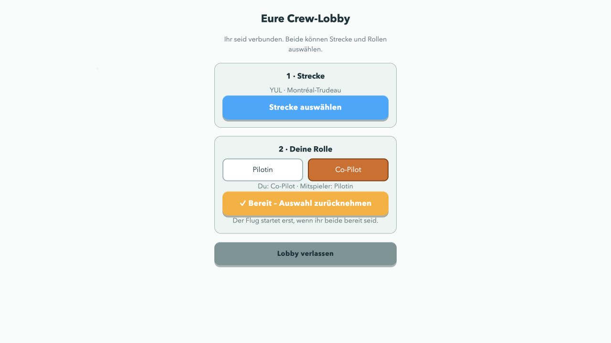
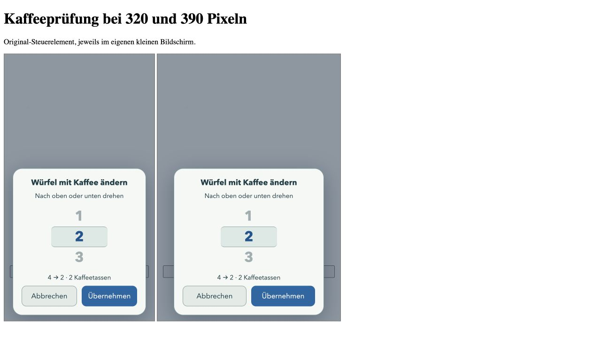
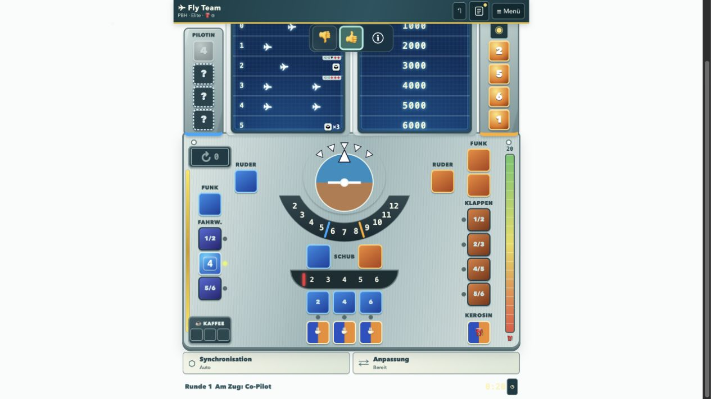

# Bedienung, Feedback und gemeinsame Lobby · 28. Oktober 2026

Negative KI-Bewertungen schließen jetzt auch physisch gleichwertige Alternativen aus: Derselbe Würfelwert auf einem anderen freien Kaffeefeld ist kein neuer Vorschlag. Ein anderes Platzierungsziel hat beim Neuversuch Vorrang. Nach einer erneut abgelehnten Aktion kann der Spieler einen besseren Zug mit den Würfeln der KI zeigen. Dabei wird die letzte KI-Aktion zurückgenommen; die Demonstration wird mit der ursprünglichen Ablehnung verknüpft und ausdrücklich positiv bewertet gespeichert. Abbrechen stellt den vorherigen Zustand wieder her. Der Modus pausiert die Echtzeituhr einschließlich der sichtbaren Anzeige. Auch nach einem geöffneten Menü bleibt die KI angehalten; Abbrechen stellt die ursprüngliche Restzeit wieder her. Eigene Vorschläge werden nur angeboten, solange der betreffende KI-Zug noch zurückgenommen werden kann.

Der Trainingsimport unterstützt diese ausdrücklich verknüpften menschlichen Korrekturen. Negative Bewertungen trainieren die gesamte Familie gleichwertiger Aktionen gemeinsam. Datenschutzentscheidung, gespeicherte legale Masken, Aufteilung nach ganzen Sitzungen und die bisherigen Mindestdaten- und Validierungsgrenzen bleiben erforderlich. Diese Änderung allein trainiert keine veröffentlichten Gewichte neu. Im zuletzt geprüften lokalen Archiv lagen 28 verwertbare Bewertungen aus 13 Sitzungen für Schema 3 vor; noch nicht archivierte Cloud-Sitzungen sind darin nicht enthalten.

Kaffeeplätze zeigen belegte Würfel in ihrer tatsächlichen Farbe. Das Kaffeesymbol neben dem gewählten Würfel öffnet eine vertikale Werteauswahl mit Kostenanzeige. Sie nutzt nur tatsächlich erlaubte Werte und passt in kleine Bildschirme. Die technische Statusleiste unter dem Spielfeld erscheint nur noch bei einer Pause oder einem Speicherproblem.

Crews stehen absteigend nach Generation; Crew 5 ist zunächst vorausgewählt. Anzeigenamen: Pionier, Horizont, Mentor, Kursmeister, Navigator. Die Modell-IDs, Gewichte und bisherigen Prüfberichte bleiben unverändert.

Im Multiplayer wird zuerst ein Raum erstellt. Beide Spieler wählen in einer gemeinsamen Lobby die Strecke und anschließend die Rollen. Der Host kann auch Co-Pilot sein. Änderungen setzen die Bereitschaft zurück; erst zwei aktuelle Bestätigungen starten das Spiel. Die Verbindung bestimmt die Rolle einer eingehenden Aktion.

Updates erkennen eine neue bereitgestellte App-Version. Sie laden zunächst die neue Oberfläche vollständig. Ein Hinweis bietet die Aktivierung im Hauptmenü an. Laufende Spiele werden nicht neu geladen. Vor dem Wechsel werden Spielstand und Aufzeichnungen gesichert; bei vorhandenem vollständigem Offline-Paket wird auch dessen neue Version vorbereitet. Unveränderte, über SHA-256 adressierte KI-Dateien bleiben im gemeinsamen Cache. GitHub-Pushes werden dadurch nach erfolgreicher Pages-Bereitstellung sichtbar. Nach Laden der neuen Oberfläche bietet auch der einmalige Wechsel von einem alten Service Worker ohne Updateprotokoll bietet im Hauptmenü einen abschließenden Reload an; bei gemischten alten/neuen Seitendateien verhindert die sichtbare Menüprüfung eine Unterbrechung laufender Spiele.

## Geprüft

- Echte PeerJS/WebRTC-Verbindung zweier Browsertabs: Gast wählt Strecke, Host spielt Co-Pilot, beide bestätigen; freie Partnerwürfel bleiben verborgen.
- Blaue und orange Kaffeewürfel auf beiden Geräten; Änderung 4 → 2 verbraucht zwei Tassen und erreicht den Host.
- Erster schlechter KI-Zug erzeugt anderes Ziel; zweiter schlechter Zug erlaubt eine eigene Platzierung mit KI-Würfeln. Die Demonstration erscheint mit positiver Bewertung und gibt die Bedienung an die eigene Rolle zurück.
- Neue Version während eines Spiels: kein Reload; nach Wechsel ins Hauptmenü Updatehinweis, Aktivierung, anschließend Fortsetzung des gespeicherten Spiels samt Demonstration.
- Echtzeitstrecke Paro/Elite: Uhr bei 0:37 angehalten, Menü geöffnet/geschlossen und mehr als 50 Sekunden gewartet; Abbrechen stellt 0:36 wieder her. Erneuter Vorschlag bei 0:30, danach nochmals mehr als 50 Sekunden gewartet und erfolgreich einen blauen Vierer aufs Fahrwerk gelegt: positive Bewertung, weiter in Runde 1, Uhr weiterhin bei 0:30.
- Original-Kaffeesteuerelement bei 320 und 390 Pixeln Breite: −2 und beide Schaltflächen vollständig sichtbar. Dies ist ein Browserlayouttest, kein Test auf einem physischen iPhone.
- Node-Prüfungen für semantische Neuversuche und Lobbyzustände; Offline-Prüfungen für Integrität, Wiederaufnahme, Speicherfehler, Versionswechsel, alle Laufzeit-/Modelldateien und Cache-Trennung.

## Weitere mobile Korrekturen

- Die Crew-Auswahl zeigt nur Nummer und Zusatzname, ohne „Entwicklung“ im Namen. Die gemessenen Testwerte und ihre Hinweise bleiben erhalten.
- Der Cockpit-Kopf und die Feedbackleiste sind deckend und ohne Unschärfefilter. Die iOS-Statusleiste verwendet den Standardmodus. Dynamische Safe-Area-Werte schützen Systemanzeigen; es werden keine festen Dynamic-Island-Abmessungen angenommen. Ein bereits installiertes iPhone-PWA kann seine Statusleisten-Einstellung bis zum erneuten Öffnen oder Hinzufügen behalten; die tatsächliche iOS-Systemdarstellung ist hier nicht auf einem physischen iPhone überprüft.
- Die Navigationsleisten passen sich der verbleibenden Bildschirmhöhe an. Würfel und Spielfelder behalten ihre Bediengröße. Reicht die Höhe nicht, scrollt das Cockpit unter dem festen Kopf. Das Startmenü hat kleinere Abstände, Titel und Schaltflächen.
- Ein wesentlich kleinerer Neuwurfdialog zeigt pro Person eine Würfelreihe. Beide dürfen „Alle behalten“ bestätigen: Dialog schließen, keine neuen Würfel, kein verbrauchtes Plättchen. Abgebrochene Auswahlereignisse werden nicht als gültige Trainingszüge gespeichert.
- Bei Echtzeit-Strecken erscheint vor dem Start das standardmäßig gesetzte Häkchen „Mit Zeitlimit spielen“. Ohne Häkchen werden aktuelle und künftige Countdown-Fristen deaktiviert. Diese Wahl übersteht Rückgängig, Speichern, Fortsetzen und Neustart und wird im Multiplayer gemeinsam bestätigt. Solche Siege zählen als Übung; Lerndaten kennzeichnen die Variante mit `scenario.timed=false`.

Geprüft: echte Pass-&-Play-Bedienung im Browser, beide leeren Bestätigungen mit erhaltenem Plättchen; Layout bei 393 × 852 mit simulierten Safe-Area-Werten 59/34, 393 × 724 und 320 × 740 ohne vertikalen oder horizontalen Überlauf des Grundspiel-Cockpits. Paro Elite ohne Zeitlimit wurde nach drei Verkehrswürfen bis zur Platzierungsphase gestartet: keine Timeranzeige, Kennzeichnung „Ohne Zeitlimit“, Cockpit passt in die iPhone-Ansicht. Das Startmenü einschließlich Fortsetzen und Offline-Download passt bei 393 × 852 und 393 × 724. Safe-Area-Simulation ersetzt keinen Test des iOS-Systemnebels auf dem Gerät.

Automatisiert: `node tests/reroll-retain.cjs` prüft die echten Handler für Pass & Play, Multiplayer und Singleplayer einschließlich Trainingsereignissen. `tests/test_play_options.py` prüft Timer-Standard, dauerhafte Abschaltung, Save/Resume und Undo. Bestehende UI- und Offline-Prüfungen bestehen.
